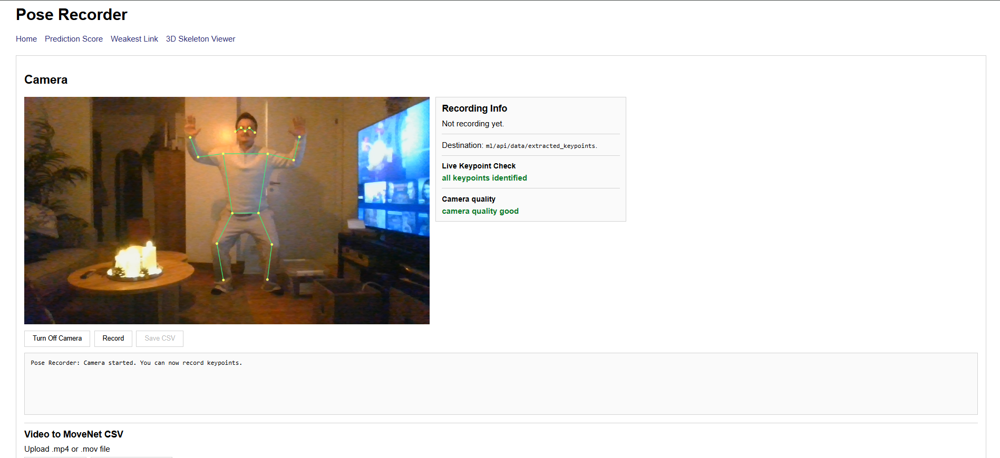
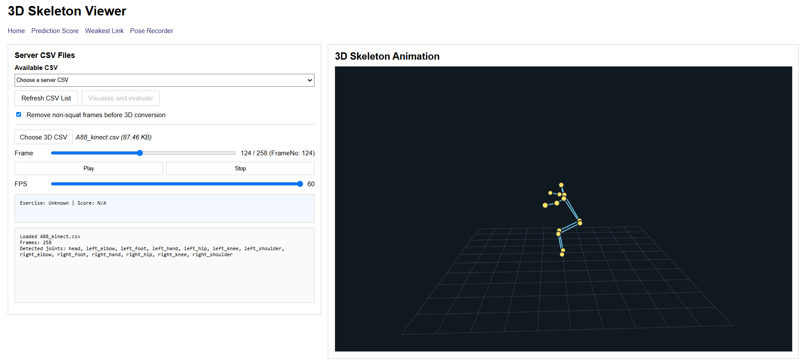
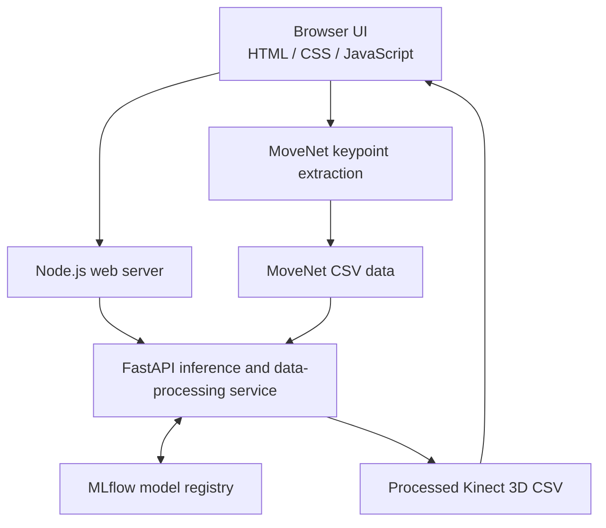
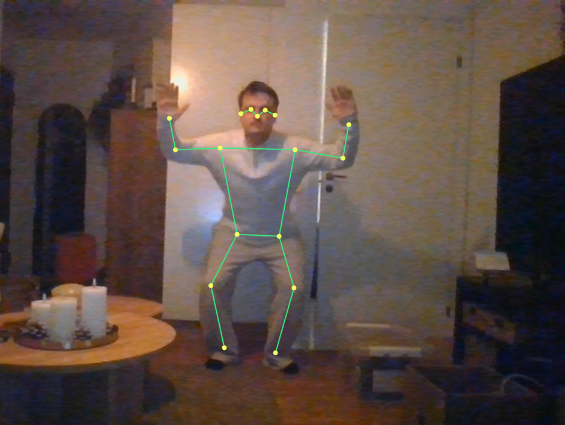
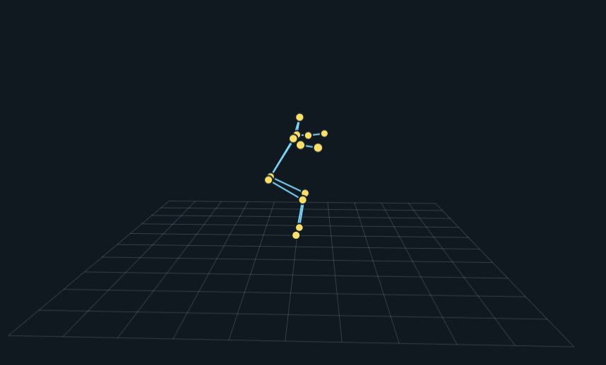

# Machine Learning Web App & Pose Recorder

A full-stack university project for **movement analysis, machine-learning predictions, and 3D skeleton visualization**. The application combines a browser interface, a Node.js web server, a FastAPI inference service, and MLflow-managed models.

Developed as a group project in **4DT907** at **Linnaeus University, Sweden**.

## Overview

The system lets users explore movement-related predictions and record or upload movement data. Its main functions include:

- **Score prediction:** Predict an AIMO movement score from angle and timing deviations.
- **Weakest-link classification:** Identify the movement component most likely to need attention from movement-derived features.
- **Pose Recorder:** Capture a movement with a camera, or process a video, and export **MoveNet 2D keypoints** as CSV.
- **Pose processing:** Upload MoveNet CSV data, remove non-exercise frames, and transform 2D MoveNet coordinates into **3D Kinect-style skeleton coordinates** using trained models.
- **3D Skeleton Viewer:** Load a processed CSV and inspect the reconstructed movement frame by frame or as an animation.

The prediction and recording workflows were developed by the team over multiple course assignments.

## Screenshots

### Pose Recorder



The recording page includes camera controls, video-to-keypoint processing, CSV upload, and downloads for processed movement data.

### 3D Skeleton Viewer



The viewer can load a 3D skeleton CSV and visualize the movement using frame and playback controls.

## Architecture



**Main technologies:** Python, FastAPI, Uvicorn, MLflow, scikit-learn, XGBoost, Node.js, JavaScript, HTML, CSS, Docker, and Docker Compose. The pose workflow also uses **MoveNet** and **Kinect-style joint representations**.

## Components

### 1. Web Application (`sw/`)

**Frontend:** Built with HTML, CSS, and JavaScript to handle user interaction, movement recording, 3D skeleton visualization, and displaying ML predictions.

**Backend:** Node.js server that handles communication between the frontend and ML inference service.

---
### 2. FastAPI Server (`ml/api/`)

- Built using **FastAPI** to expose trained machine learning models through REST endpoints.

- Handles input validation, model loading, inference, and prediction responses.

- Supports endpoints such as /predict, /health, and /features.

**Key modules:**

- `main.py` – FastAPI application entry point  
- `routers/` – API route definitions  
- `services/inference.py` – Inference logic  
- `core/model_loader.py` – Loads models
- `core/model_registry.py` – Handles model registry logic
---
### 3. MLflow Service

MLflow is used as the central system for managing, storing, and serving machine learning models in this project. It ensures that models can be versioned, tracked, and reliably accessed by the FastAPI inference server.

- Manages machine learning experiments, model versions, and registered models.

- Provides centralized access to trained models for the inference service.

- Supports reproducibility and separation of model training from deployment.

---
The components are containerized using **Docker and Docker Compose.**

## Machine-learning work

The project explored several machine learning techniques, including:

- **Classification:** Predicting the weakest link in movement assessments using XGBoost.

- **Regression:** Predicting AIMO movement scores.

- **Ensemble learning:** Random Forest, XGBoost, CatBoost, and stacking ensembles.

- **Clustering:** Exploring patterns and similarities in movement data.

- **Dimensionality reduction:** Principal Component Analysis (PCA).

- **Pose estimation:** Using MoveNet to extract body keypoints from video.

- **3D pose reconstruction:** Converting 2D movement data into 3D Kinect-style skeleton representations.

- **Model evaluation:** Cross-validation, hyperparameter tuning, and performance comparison.

- **MLOps:** Experiment tracking, model versioning, and registration using MLflow.

Some methods were explored during research and experimentation and were not necessarily integrated into the final version of the application.

## Repository structure

```text
sw/
  frontend/             # Browser interface
  backend/              # Node.js web server
ml/
  api/                  # FastAPI endpoints and inference services
  models/
    research/            # Model experiments and training notebooks
```

The application communicates with the FastAPI service over HTTP. The inference service retrieves models from MLflow or configured local storage.

## Running locally

### Prerequisites

- Docker and Docker Compose
- Access to any required models, data, and MLflow services

From the repository root:

```bash
docker compose build
docker compose up -d
```

The original project documentation shows the web service on **http://localhost:3000** and the FastAPI service on **http://localhost:8000**.

Stop the services with:

```bash
docker compose down
```

**Availability note:** The original MLflow deployment requires access to the Linnaeus University network or VPN. A public clone may therefore need updated model paths, credentials, or local model artifacts before every feature can run. The original university-hosted demo may no longer be available.

## My contributions — Agust Eliasson

This was a collaborative group project. My work included:

- **Software development:** Worked on the software-development side of the project as part of the web application and API team.
- **Pose estimation and 3D visualization:** Worked with MoveNet and Kinect models, integrating them into the application to process movement data and generate 3D skeleton representations. Developed and connected the 3D Skeleton Viewer to display and animate the resulting movement data.
- **Ensemble-learning experiment:** Implemented training and prediction scripts for **stacking ensembles** in both regression and classification, including base-model predictions and a meta-model that learns to combine them.
- **Team workflow:** Participated in a project organized with GitLab issues, milestones/sprints, branches, merge requests, and code reviews.

## Team

- Agust Eliasson
- Petter Gustafsson
- Kim Wong
- Elliot Ehn

Developed for the **4DT907 "Project in data intensive systems"** Master's level course at Linnaeus University, spring 2026.


  <tr>
    <td width="40%">
      
    </td>
    <td width="50%">
      
    </td>
  </tr>
</table>